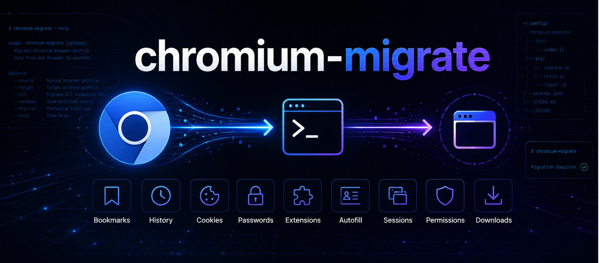
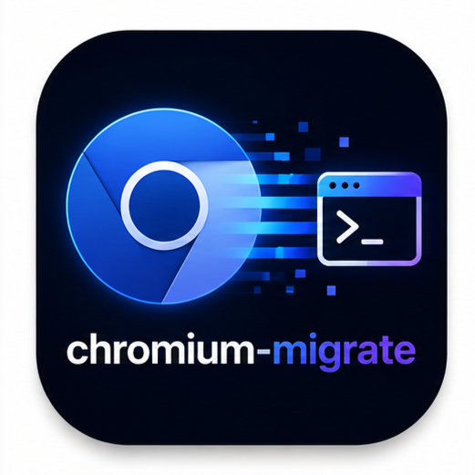
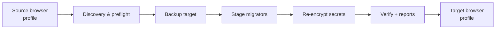

<p align="center">
  
</p>

<p align="center">
  
</p>

<h1 align="center">chromium-migrate</h1>

<p align="center">
  <strong>Production-grade CLI to migrate Chromium browser profiles between browsers</strong><br />
  Chrome · Brave · Arc · Edge · Vivaldi · Opera · Chromium · and more
</p>

<p align="center">
  <a href="https://github.com/IshankDev/chromium-migrate/blob/main/LICENSE"></a>
  <a href="https://nodejs.org/"></a>
  <a href="https://www.typescriptlang.org/"></a>
  <a href="https://github.com/IshankDev/chromium-migrate/stargazers"></a>
  <a href="https://github.com/IshankDev/chromium-migrate/issues"></a>
</p>

<p align="center">
  <a href="#quick-start">Quick start</a> ·
  <a href="#features">Features</a> ·
  <a href="#supported-browsers">Browsers</a> ·
  <a href="#cli">CLI</a> ·
  <a href="#architecture">Architecture</a> ·
  <a href="#security">Security</a> ·
  <a href="#contributing">Contributing</a>
</p>

---

## Why chromium-migrate?

Switching browsers usually means weeks of friction: lost bookmarks, dead sessions, re-typing passwords, and hunting down extensions.

**chromium-migrate** copies a full Chromium user profile from one browser to another — locally, safely, and verifiably.

| | |
| --- | --- |
| **Safe by default** | Target profile is backed up before any write. Rollback in one command. |
| **Secrets stay secret** | Passwords & cookies are re-encrypted in memory. Never logged. Never written plaintext. |
| **Browser-agnostic** | Registry-driven paths for Chrome, Brave, Arc, Edge, Vivaldi, Opera, and more. |
| **Production CLI** | Progress UI, dry-run estimates, JSON/Markdown/HTML reports, batched SQLite I/O. |

```bash
chromium-migrate migrate --from arc --to brave -y
```

---

## Features

| Capability | Details |
| --- | --- |
| Bookmarks | Full folder tree, order, dates; Arc sidebar favorites imported when source is Arc |
| History & downloads | Large profiles (100k+ history rows) via batched SQLite |
| Passwords | Keychain / Safe Storage re-encryption on macOS |
| Cookies | Network/Cookies layout + encrypted value re-keying |
| Autofill | Addresses, form history, masked card metadata |
| Extensions | Packages + local/sync settings + compatibility notes |
| Sessions | Current / Last Session & Tabs |
| Permissions | Camera, mic, notifications, location, and more |
| Preferences | Compatible Chromium prefs (theme, startup, search, zoom, …) |
| Favicons / Top Sites | Databases copied and count-verified |
| Dry-run | Item counts, disk estimate, unsupported surface list — zero writes |
| Reports | JSON · Markdown · HTML under `reports/` |

---

## Supported browsers

| ID | Browser | Notes |
| --- | --- | --- |
| `chrome` | Google Chrome | |
| `chrome-canary` | Chrome Canary | |
| `chromium` | Chromium | |
| `brave` | Brave | |
| `arc` | Arc | Spaces/Boosts not portable; sidebar → bookmarks |
| `edge` | Microsoft Edge | |
| `vivaldi` | Vivaldi | |
| `opera` | Opera | |
| `opera-gx` | Opera GX | |
| `thorium` | Thorium | |
| `dia` | Dia | Experimental |
| `aside` | Aside | Experimental |

```bash
chromium-migrate browsers    # paths for your OS
chromium-migrate profiles    # installed profiles + sizes
```

Add another Chromium browser with a single entry in [`src/browsers/registry.ts`](./src/browsers/registry.ts).

---

## Install

### Prerequisites

- **Node.js 22+**
- Build tools for native modules (`better-sqlite3`, `keytar`)
- On macOS: Xcode Command Line Tools

```bash
git clone https://github.com/IshankDev/chromium-migrate.git
cd chromium-migrate
npm install
npm run build
npm link   # installs `chromium-migrate` and `cmigrate`
```

```bash
# without linking
node dist/cli.js --help
npm run dev -- profiles
```

```bash
# rebuild natives if install fails
npm rebuild better-sqlite3 keytar
```

> The first password/cookie migration may prompt for OS keychain access — allow it for Safe Storage.

---

## Quick start

```bash
# 1. Discover
chromium-migrate profiles

# 2. Preview (no writes)
chromium-migrate dry-run --from arc --to brave

# 3. Migrate (terminates browsers, backs up target)
chromium-migrate migrate --from arc --to brave -y

# 4. Verify
chromium-migrate verify --from arc --to brave

# 5. Something wrong? roll back
chromium-migrate rollback
```

### More examples

```bash
chromium-migrate migrate --from chrome --to brave -y
chromium-migrate migrate --from brave --to edge --source-profile "Profile 1"
chromium-migrate migrate --from edge --to vivaldi --no-passwords
chromium-migrate dry-run --from opera --to chrome
chromium-migrate backup create --browser brave -y
```

---

## CLI

| Command | Description |
| --- | --- |
| `migrate` | Migrate `--from` → `--to` |
| `verify` | Compare source vs target counts |
| `backup create` / `backup list` | Snapshot a profile |
| `rollback [id]` | Restore the latest (or given) backup |
| `dry-run` | Estimate without writing |
| `profiles` | List discovered profiles |
| `browsers` | List supported browsers + expected paths |
| `report` | Show generated reports |
| `clean` | Prune old backups / logs / reports |

**Binaries:** `chromium-migrate` · `cmigrate` · legacy `arc2brave`

### Flags

| Flag | Description |
| --- | --- |
| `-f, --from <browser>` | Source browser id |
| `-t, --to <browser>` | Target browser id |
| `--source-profile` / `--target-profile` | Profile folder (default `Default`) |
| `--no-passwords` / `--no-cookies` / … | Skip individual stages |
| `--skip-backup` | Skip target snapshot |
| `-y, --terminate` | Quit browsers without prompting |
| `-v, --verbose` | Debug logging |

---

## Platform support

| Platform | Discovery | DB copy | Password / cookie re-encrypt |
| --- | --- | --- | --- |
| **macOS** | ✅ | ✅ | ✅ Keychain + AES-128-CBC |
| **Linux** | ✅ | ✅ | ⚠️ via keytar; may copy blobs as-is |
| **Windows** | ✅ | ✅ | ❌ DPAPI not yet — blobs copied as-is |

Paths use portable `{home}` templates — never hardcoded to a username or machine.

```bash
export CHROMIUM_MIGRATE_HOME=/path/to/workdir   # logs, backups, reports
```

---

## Architecture



```
src/
  browsers/     Registry · discovery · process control
  migration/    Stage migrators · orchestrator · verify
  services/     Backup · crypto / Safe Storage
  database/     Batched transactional SQLite helpers
  commands/     CLI (commander)
  reports/      JSON / Markdown / HTML
  utils/        Logging · progress UI · helpers
```

---

## Security

chromium-migrate is designed for **local** migration of **your own** profiles.

- Decrypt only in process memory for re-encryption
- Never print, log, or persist plaintext passwords / cookie values
- Redacted logging by default
- Prefer quitting browsers cleanly before migrate

See [SECURITY.md](./SECURITY.md) to report vulnerabilities privately.

### Not portable

- Browser-specific UI (Arc Spaces / Boosts, Vivaldi panels, Opera workspaces)
- Cloud sync / account session state
- Full credit-card PANs (masked / tokenized metadata only)

---

## Development

```bash
npm install
npm run typecheck
npm test
npm run build
npm run dev -- browsers
```

---

## Roadmap

- [ ] Windows DPAPI password/cookie re-encryption
- [ ] Stronger Linux secret-service integration
- [ ] Firefox → Chromium adapters (experimental)
- [ ] npm package publish + Homebrew formula
- [ ] Guided TUI mode

Vote with 👍 on issues — PRs welcome.

---

## Contributing

We welcome browser definitions, platform crypto work, tests, and docs.

1. Read [CONTRIBUTING.md](./CONTRIBUTING.md)
2. Follow the [Code of Conduct](./CODE_OF_CONDUCT.md)
3. Open a PR with clear test notes

<p align="center">
  <a href="https://github.com/IshankDev/chromium-migrate/stargazers">⭐ Star the repo</a>
  if this saved you a weekend of re-logins.
</p>

---

## License

[MIT](./LICENSE) © chromium-migrate contributors

<p align="center">
  
</p>
